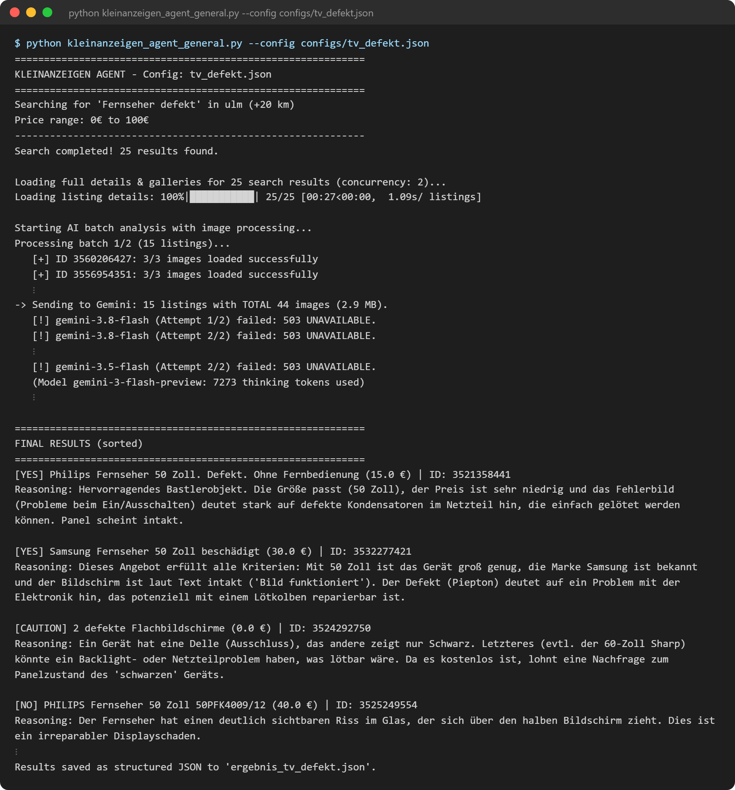
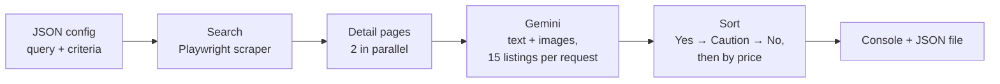

# Kleinanzeigen Agent

Searches [Kleinanzeigen](https://www.kleinanzeigen.de) for listings and lets Google Gemini rate each one
(text **and** all images) against criteria you write in plain language. The result is a sorted list:
`Yes` → `Caution` → `No`, cheapest first.



<sub>Real output from a run on 2026-11-05 (`tv_defekt.json` with `max_pages: 1`), shortened where marked with ⋮. Gemini answers in German because the criteria are written in German.</sub>

## How it works



1. **Search:** The scraper ([`ebay-kleinanzeigen-api-mcp`](https://github.com/flo-bauer/ebay-kleinanzeigen-api-mcp),
   included as a git submodule) opens the search result pages in headless Chromium and collects listing IDs.
2. **Detail pages:** For every hit it loads the full description and the image gallery.
3. **Rating:** Listings go to Gemini in batches. Each listing's images follow directly after its text, so the model
   can tell which photo belongs to which listing. The answer is forced into a Pydantic schema
   (`listing_id`, `title`, `price_eur`, `recommendation`, `reasoning`), so there is no free-text parsing.
4. **Sorting and output:** Results are sorted and saved as JSON.

## Design decisions

### Only 2 detail pages in parallel

The first version loaded 5 detail pages at once. Kleinanzeigen then blocked the whole IP range for a while
and the search returned 0 results. With 2 parallel browser contexts, 25 detail pages take about 30 seconds.
That is not the bottleneck: the Gemini call takes longer. Going faster would risk the block and gain nothing.

### Fallback chain for the models

Gemini models are tried in a fixed order, newest first (`LLM_MODELS` in the script). Each model gets 2 attempts
with a short pause. On an error like `503 UNAVAILABLE` the agent moves on to the next model. Every request has a
180-second timeout, so a request that hangs cannot block the run. The screenshot shows a real case:
the four newest models were overloaded and `gemini-3-flash-preview` answered. If every model fails, that batch
is skipped and the remaining batches still run.

### Prices come from the scraper, not from the model

Gemini also returns a price, but the agent overwrites it with the price parsed from the listing itself
(`parse_price_eur`). An LLM can misread `1.000 €` or invent a number. Parsing the price is deterministic and testable.
"Zu verschenken" (free) becomes `0.0`. The sort checks `is None` explicitly, because `0.0` is falsy in Python and
`price or inf` would put free items at the end instead of the top.

## Setup

Requires Python 3.11+ and a [Gemini API key](https://aistudio.google.com/app/apikey).

```bash
git clone --recursive https://github.com/flo-bauer/kleinanzeigen-agent.git
cd kleinanzeigen-agent
python -m venv .venv
.venv/bin/pip install -r requirements.txt      # Windows: .venv\Scripts\pip
.venv/bin/python -m playwright install chromium
cp .env.example .env                           # then put your key into .env
```

Already cloned without `--recursive`? Run `git submodule update --init`.

## Usage

```bash
.venv/bin/python kleinanzeigen_agent_general.py --config configs/tv_defekt.json
```

The agent prints the rated listings and writes them as JSON to `output_file`.

## Config

One JSON file per search, see [`configs/tv_defekt.json`](configs/tv_defekt.json):

| Key | Meaning |
|---|---|
| `search.query` | Search term |
| `search.location` | City or postal code |
| `search.radius_km` | Search radius |
| `search.min_price`, `search.max_price` | Price range in EUR (optional) |
| `search.max_pages` | Result pages to fetch (~25 listings each) |
| `manual_listings` | Extra listing IDs to rate in addition to the search |
| `criteria` | What you are looking for: requirements, nice-to-haves, exclusions. Free text, sent to Gemini as is. |
| `output_file` | Where the results are saved (default `analysis_result.json`) |

Output per listing: `listing_id`, `title`, `price_eur`, `recommendation` (`Yes`/`No`/`Caution`), `reasoning`.

## Notes

- **Be gentle with Kleinanzeigen.** Keep `max_pages` low. If you suddenly get 0 results, your IP is probably
  blocked for a while. Wait and try again later.
- Unofficial tool, not affiliated with Kleinanzeigen. Use it for personal searches and respect their terms.

## License

MIT, see [LICENSE](LICENSE).
